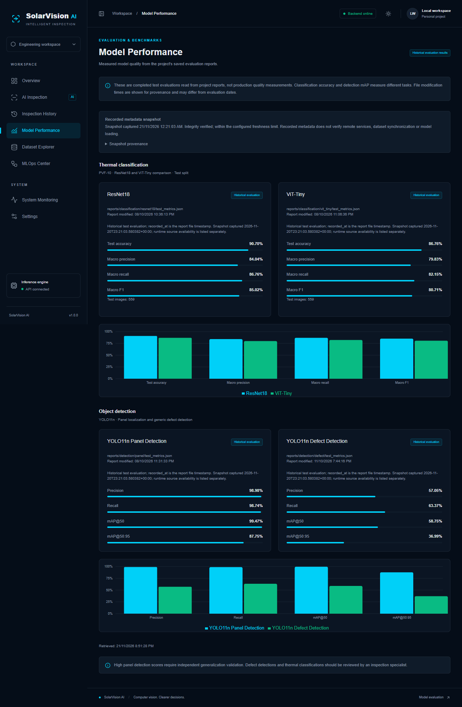
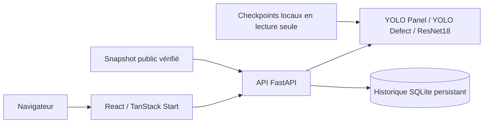

# SolarVision AI

Plateforme d’inspection solaire : React/TypeScript avec TanStack Start et le design Lovable existant, API FastAPI, détection YOLO11n et classification thermique ResNet18. ViT-Tiny reste un modèle de comparaison scientifique ; il n’est pas déployé pour l’inférence.

Le déploiement local Kubernetes a été validé le **21 novembre 2026** : trois modèles réels, huit pages, treize scénarios navigateur réussis et historique SQLite préservé. Cette validation locale est distincte de la CI GitHub des changements à publier, qui reste en attente de publication autorisée. Les métriques scientifiques affichées sont des évaluations historiques, pas des mesures de qualité en production.

- [Résultats et périmètre de validation](docs/validation/kubernetes-validation.md)
- [Reproduire les contrôles sur un clone propre](docs/ci.md)
- [Tests navigateur avec modèles locaux](frontend/E2E.md)
- [Politique de publication des données et des preuves](docs/publication.md)



Capture du déploiement validé, sans image de dataset ni historique d'inspections. Les jeux de données, poids, bases et preuves brutes restent locaux ; les pointeurs DVC et le snapshot public décrivent les artefacts disponibles sans les télécharger.

## Architecture



La CI teste les contrats avec des doubles et construit les images sans poids ni datasets. L'application utilise les vrais checkpoints pour l'inférence ; elle n'invente pas de prédictions lorsque ceux-ci sont absents. Dans un clone sans poids, `/health` reste disponible et `/ready` répond503, tandis que les métadonnées publiques restent consultables. Les tests d'inférence réelle sont une campagne locale distincte.

## Démarrage local sous Windows

Utiliser deux terminaux PowerShell depuis `C:\SolarVision`. Conserver l’environnement CUDA existant s’il fonctionne ; l’image Docker décrite plus bas utilise PyTorch CPU.

Backend :

```powershell
.\.venv\Scripts\Activate.ps1
python -m pip install -r requirements.txt
python -m uvicorn src.api.main:app --host 127.0.0.1 --port 8000
```

Les trois checkpoints doivent déjà être présents :

```text
runs/detect/runs/solarvision/panel_detection_full/weights/best.pt
runs/solarvision/defect_detection_full-2/weights/best.pt
models/classification/resnet18_best.pth
```

Aucun téléchargement de poids, entraînement ou `dvc push` n’est lancé par le dashboard. L’API charge les modèles au démarrage et choisit CUDA lorsque PyTorch le permet. Vérifier `http://127.0.0.1:8000/health` et la documentation interactive `http://127.0.0.1:8000/docs`.

Frontend, avec Node.js 22 et Bun :

```powershell
Set-Location C:\SolarVision\frontend
bun install --frozen-lockfile
bun run dev --host 127.0.0.1 --port 8081
```

Ouvrir `http://localhost:8081`. Dans **Settings**, enregistrer `http://127.0.0.1:8000` et tester la connexion. L’URL sauvegardée dans le navigateur reste prioritaire. En production Node, `SOLARVISION_PUBLIC_API_BASE_URL` configure la valeur initiale à l’exécution via `/solarvision-config.js`, sans reconstruire l’image. `VITE_API_BASE_URL` reste un fallback de développement/build. Les origines HTTP `localhost` et `127.0.0.1` aux ports 8080, 8081 et 8082 sont explicitement autorisées par l’API ; les autres origines sont refusées sauf ajout explicite à `SOLARVISION_CORS_ORIGINS` avant démarrage.

L’adresse API désigne la machine vue par le navigateur. Pour un navigateur sur une autre machine, utiliser l’adresse réseau du serveur et autoriser son origine frontend. Une page HTTPS doit accéder à une API HTTPS. Aucun secret ne doit être mis dans une variable `VITE_*`, car ces valeurs font partie du JavaScript public.

## Inspection et données

**AI Inspection** accepte JPG, JPEG, PNG, TIFF et TIF jusqu’à 20 Mio. Choisir le modèle puis lancer l’analyse ; le navigateur envoie réellement l’image à FastAPI. Les détections affichent leurs classes, confiances et coordonnées ; la classification affiche les probabilités renvoyées par le checkpoint. Les rapports JSON et les images annotées peuvent être téléchargés.

ResNet18 attend des images thermiques de modules compatibles avec PVF-10. Une photographie RGB ordinaire n’est pas une entrée équivalente. La confirmation explicite de compatibilité thermique est nécessaire ; le serveur ne peut pas prouver la modalité ou la provenance d’une image à partir de ses seuls canaux RGB. Le redimensionnement, la conversion de canaux et la normalisation suivent le prétraitement du modèle entraîné, sans convertir une photographie visible en mesure thermique.

Le cache d’historique est isolé par URL API normalisée : changer de backend ne copie pas ses inspections vers un autre serveur. Les anciens enregistrements de navigateur sans provenance restent préservés séparément et exportables dans Settings ; leur import dans l’API choisie exige une action explicite. La synchronisation d’un même backend insère uniquement les IDs manquants. Un cache malformé est conservé pour récupération et ne masque pas l’historique serveur. Une base SQLite backend fournit une persistance complémentaire ; sa destination locale par défaut est `data/inspections.sqlite3`, configurable avec `SOLARVISION_HISTORY_DB`. Sauvegarder ce fichier avec les procédures habituelles. Le dashboard n’ajoute ni authentification ni gestion multi-utilisateur : réserver l’API à un environnement de confiance ou la placer derrière un proxy authentifié avant toute exposition publique.

Contrats principaux :

| Endpoint | Données |
| --- | --- |
| `GET /health` | Disponibilité API, modèles chargés et environnement d’inférence. |
| `GET /ready` | HTTP200 seulement si les trois modèles sont disponibles ; HTTP503 si un modèle manque. `/health` conserve la sémantique de liveness avec HTTP200 et les disponibilités détaillées. |
| `POST /predict/panels`, `POST /predict/defects` | Formulaire multipart `file`, détections, classes, confiances et `inference_ms`. |
| `POST /predict/classify` | Multipart `file` et `thermal_confirmed=true`, classe et probabilités réelles. Les images thermiques brutes 16 bits nécessitent une conversion scientifique appropriée en entrée 8 bits compatible. |
| `GET /inspections?limit=500&offset=0` | Historique paginé `{records, total}`. |
| `POST /inspections/import` | `{records: [...]}`, au plus 100 par lot, insertion des identifiants manquants uniquement. |
| `GET /inspections/{id}/image` | Aperçu PNG de l’inspection enregistrée, dimension maximale de 1600 pixels. |
| `GET /dashboard`, `GET /monitoring` | Métadonnées autorisées en lecture seule et télémétrie réelle. |

Une prédiction expose aussi `image_width`, `image_height`, `inspection_id`, `created_at` et, si l’enregistrement a échoué, `persistence_error`. `inference_ms` mesure le modèle. `request_duration_ms` mesure le traitement serveur après parsing multipart et jusqu’au premier INSERT SQLite ; la mise à jour de la mesure, le commit final, la sérialisation et le transport sont exclus. Ce champ ne prétend pas mesurer toute la durée HTTP. `client_duration_ms`, présent dans le rapport navigateur, mesure le temps perçu de bout en bout, transfert et lecture JSON compris. Pour les nouvelles inspections, `duration` correspond à `inference_ms`. Les anciens historiques/exports restent lisibles sans réécriture ; un ancien `duration` sans mesure explicite est présenté comme une durée de provenance inconnue.

L’onglet Original et le canevas annoté s’excluent visuellement. Une image JPEG/PNG décodable reste à sa résolution d’origine pour la prévisualisation et l’export annoté, même au-dessus de1600px. Pour un TIFF non décodable par le navigateur, l’interface utilise l’aperçu PNG retenu par le serveur (au plus1600px) et indique distinctement ses dimensions, celles de l’upload et la résolution d’export.

Les huit pages utilisent les informations disponibles :

- **Overview** : connexion réelle, disponibilité des modèles et inspections enregistrées.
- **AI Inspection** : inférences indépendantes YOLO panneaux, YOLO défauts et ResNet18 thermique.
- **Inspection History** : recherche, filtres, consultation et export des inspections.
- **Model Performance** : évaluations historiques présentes dans `reports/**/test_metrics.json`, distinctes de la production.
- **Dataset Explorer** : sept fichiers DVC sous `data/raw/`, leur empreinte/version de contenu, tailles et statistiques accessibles. L’existence d’un pointeur `.dvc` ne prouve pas que les données sont téléchargées ou synchronisées avec un remote.
- **MLOps Center** : checkpoints, historiques CSV d’entraînement et expériences/métriques de `mlflow.db`, en lecture seule. Aucun endpoint ne lance de commande arbitraire.
- **System Monitoring** : mesures réelles de requêtes, erreurs, latence et ressources disponibles. Les compteurs en mémoire repartent au redémarrage de l’API ; l’absence de métriques GPU ou système est indiquée.
- **Settings** : configuration API, test de connexion, préférences d’analyse et de thème.

Une source absente est indiquée **Unavailable** ou **Not configured**, sans métriques ni runs artificiels. Les métadonnées d’un entraînement passé ne constituent pas une mesure temps réel de la qualité des prédictions.

## Docker Compose (CPU)

Docker Desktop doit être démarré en mode conteneurs Linux. Les datasets et checkpoints restent sur l’hôte et sont montés en lecture seule. L’historique utilise le volume nommé `solarvision-history` ; ne pas utiliser `docker compose down -v` si cet historique doit être conservé.

```powershell
docker compose config --quiet
docker compose build
docker compose up -d
docker compose ps
docker compose logs --tail 100 solarvision-api
```

Le frontend est disponible sur `http://localhost:8081`, l’API sur `http://127.0.0.1:8000`. Le frontend attend que le healthcheck `/ready` confirme les trois modèles. Son conteneur exécute la sortie Node de TanStack Start, construite avec `NITRO_PRESET=node_server` ; la configuration Lovable est conservée. Le Compose fournit `SOLARVISION_PUBLIC_API_BASE_URL` à l’exécution : modifier cette variable ne demande pas de nouveau build frontend, mais demande la recréation de son conteneur lors d’un déploiement autorisé.

Choisir normalement un seul backend sur le port8000 : local CUDA ou Docker CPU. Sous Windows, un processus Python et Docker Desktop peuvent répondre différemment selon l’interface IPv4/IPv6 ; ne pas déduire le runtime de `localhost`. Vérifier `/health.device` et utiliser des ports distincts pour exécuter simultanément CUDA et Docker CPU. Les tests post-correction utilisent18800/18801/18802 et8181/8182 avec des historiques jetables, sans toucher à8000/18000.

Le fichier MLflow SQLite local n’est pas suivi par Git et peut être absent d’un clone. Pour intégrer un `mlflow.db` déjà présent, activer le montage facultatif :

```powershell
docker compose -f compose.yaml -f compose.mlflow.yaml config --quiet
docker compose -f compose.yaml -f compose.mlflow.yaml up -d
```

Ce montage est en lecture seule et refuse de créer un répertoire si le fichier manque. Sans cet override, le magasin SQLite live n’est pas monté, mais ses métadonnées enregistrées restent disponibles via le snapshot public vérifié, avec leur provenance. Il en va de même pour les noms des remotes DVC lorsque leur configuration n’est pas montée : la configuration enregistrée ne prouve ni accès distant ni synchronisation.

La première construction de l’API installe PyTorch CPU et peut être longue. Son installation possède une couche distincte, avant les dépendances du projet et la copie du code, pour conserver le cache lors d’un changement de `requirements.txt`. Le Compose local monte aussi `src/` en lecture seule : un changement Python demande seulement un redémarrage. Ne reconstruire que le service concerné :

```powershell
docker compose build solarvision-frontend
docker compose up -d --no-deps solarvision-frontend
# Après un changement de code Python uniquement :
docker compose restart solarvision-api
# Après une modification des dépendances Python ou du Dockerfile :
docker compose build solarvision-api
docker compose up -d --no-deps solarvision-api
```

Les checkpoints modifiés sur l’hôte ne demandent aucune reconstruction ; redémarrer l’API pour les recharger. Ce Compose n’active pas le GPU. Le lancement local dans l’environnement CUDA reste le chemin GPU. Aucune commande de nettoyage des données, de téléchargement DVC ou d’entraînement n’est nécessaire au démarrage.

Pour changer l’adresse API initiale d’un conteneur frontend, définir `SOLARVISION_PUBLIC_API_BASE_URL` sur l’adresse accessible au navigateur. Compose utilise8000 ; le manifeste Kubernetes utilise18000 pour le port-forward de validation. Une adresse interne telle que `http://solarvision-api:8000` n’est pas une URL du navigateur hôte. Les préférences déjà enregistrées dans Settings gardent la priorité, même si une nouvelle valeur par défaut est configurée.

## Métadonnées publiques reproductibles

Les images API embarquent uniquement `configs/dashboard-snapshot.json`, un snapshot public vérifiable des quatre évaluations, sept descripteurs DVC, quatre versions enregistrées, cinq résumés CSV et du workflow CI. Il ne contient ni dataset, ni poids, ni base SQLite MLflow, ni répertoire `mlruns`, ni URL de remote ou identifiant OAuth. La capture utilise les sources réelles en lecture seule :

```powershell
.\.venv\Scripts\python.exe -B scripts/build_dashboard_snapshot.py
.\.venv\Scripts\python.exe -B scripts/build_dashboard_snapshot.py --check
```

La première commande exige que toutes les sources attendues soient présentes et ne lance aucun entraînement, transfert DVC ou changement de registre. Le snapshot inclut sa date, les SHA256 de provenance et les empreintes du contenu/manifeste. Il doit être relu puis reconstruit lorsqu’une source scientifique change. `--check` ne le modifie pas et signale une source montée différente. Une empreinte vérifie l’intégrité, sans constituer une signature d’éditeur.

Le runtime privilégie les sources montées, même corrompues (elles sont alors signalées indisponibles), et utilise le snapshot validé pour les sources absentes. Les champs DVC et leurs statistiques/splits ont une provenance indépendante. Les pages affichent la provenance, la date et la fraîcheur du snapshot ; après30jours il est marqué ancien, seuil configurable par `SOLARVISION_DASHBOARD_SNAPSHOT_MAX_AGE_SECONDS`. Un snapshot malformé ou modifié est refusé. Les checkpoints réellement présents et les modèles chargés restent mesurés dans le runtime : aucune présence de fichier ou version du registre ne prouve une inférence opérationnelle. La configuration des remotes, leur accessibilité et la synchronisation des artefacts sont trois notions distinctes ; les deux dernières ne sont pas vérifiées à distance par le dashboard.

## Livraison Kubernetes locale validée

Les manifests corrigés et les images `solarvision-api:postfix-20261121` / `solarvision-frontend:postfix-20261121` ont été livrés et validés sur le cluster local `kind-solarvision`. Voir la [synthèse publique](docs/validation/kubernetes-validation.md). La construction d'une nouvelle image ou une exécution CI ne met pas à jour les pods. Les commandes suivantes documentent la procédure déjà validée ; tout nouveau déploiement exige une décision explicite :

```powershell
kind load docker-image solarvision-api:postfix-20261121 solarvision-frontend:postfix-20261121 --name solarvision
kubectl --context kind-solarvision -n solarvision apply -f kubernetes/solarvision-api.yaml -f kubernetes/solarvision-frontend.yaml
kubectl --context kind-solarvision -n solarvision rollout status deployment/solarvision-api
kubectl --context kind-solarvision -n solarvision rollout status deployment/solarvision-frontend
```

Pour accéder ensuite aux services ClusterIP depuis le navigateur hôte, si ces ports ne sont pas déjà exposés, ouvrir deux terminaux distincts :

```powershell
kubectl --context kind-solarvision -n solarvision port-forward service/solarvision-frontend 8082:8081
```

```powershell
kubectl --context kind-solarvision -n solarvision port-forward service/solarvision-api 18000:8000
```

Les manifests conservent les volumes existants et leurs checkpoints en lecture seule. La readiness devient `/ready` ; la liveness reste `/health`. Après un déploiement autorisé, vérifier via8082/18000 une origine navigateur vierge, les préférences existantes, les huit pages, le snapshot, les trois inférences et la persistance, puis refaire le verdict sur le déploiement réel. Ne pas supprimer de PVC, de volume ou d’historique.

## Vérification

Tests API et métadonnées, sans entraînement :

```powershell
.\.venv\Scripts\python.exe -m pip install pytest httpx
.\.venv\Scripts\python.exe -m pytest -v
.\.venv\Scripts\python.exe -m compileall -q src
```

`pytest.ini` limite la découverte à `tests/`. Les fichiers `src/**/test_*.py` sont des scripts historiques d’inférence/évaluation qui nécessitent les poids et les datasets ; ils ne font pas partie de la suite unitaire automatisée.

Vérification facultative avec les vrais checkpoints et de vraies images du projet, sans entraînement :

```powershell
# Processus local indépendant, base d’historique temporaire (CUDA si disponible) :
.\.venv\Scripts\python.exe -m scripts.verify_fullstack
# API déjà lancée, par exemple le service Docker CPU :
.\.venv\Scripts\python.exe -m scripts.verify_fullstack --base-url http://127.0.0.1:8000
```

Ce contrôle vérifie les trois inférences, les aperçus enregistrés, l’historique, les quatre origines CORS locales, le dashboard et le monitoring. Il nécessite les images sous `data/interim/{panel_detection,defect_detection}/test/images` et `data/processed/pvf10_grouped/test`. Le mode `--base-url` ajoute trois inspections réelles à l’historique du serveur. Les rapports de validation sont écrits sous `outputs/integration/`.

```powershell
Set-Location C:\SolarVision\frontend
bunx tsc --noEmit
bun run test
bun run lint
bun run build
# Sortie autonome utilisée par Docker :
$env:NITRO_PRESET='node_server'
bun run build
$env:HOST='127.0.0.1'
$env:PORT='8081'
node .output/server/index.mjs
```

Le workflow GitHub Actions contrôle Python, les contrats API, TypeScript, lint, les tests unitaires, les builds et les images Docker sans publier d'image ni modifier Kubernetes. Le [guide CI](docs/ci.md) distingue le smoke sans poids des inférences réelles. Les tests de contrat utilisent des doubles de modèles uniquement dans les tests ; l’application n’utilise aucune prédiction simulée. Une validation d'inférence réelle nécessite les checkpoints autorisés montés en lecture seule.
