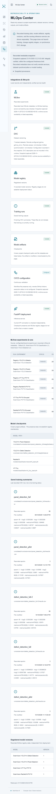

# Validation locale Kubernetes — 21 novembre 2026

SolarVision AI a été validé sur le cluster local Kind `kind-solarvision`, dans le namespace `solarvision`. **Verdict : READY pour ce périmètre local vérifié.** La préparation GitHub du 22 novembre est distincte : aucun succès d'une nouvelle CI des changements non publiés n'est revendiqué.

Cette synthèse est publique. Les rapports détaillés et leurs preuves brutes sont conservés localement : ils contiennent des historiques d'inspection, des sauvegardes SQLite et des réponses de diagnostic qui ne font pas partie du dépôt à publier.

## Résultats observés

| Vérification | Résultat |
|---|---|
| Rollouts API/frontend | Réussis ; pods Running/Ready, aucun redémarrage observé à la clôture |
| Modèles réels | YOLO11n Panel : 14 détections ; YOLO11n Defect : 1 ; ResNet18 PVF-10 : classe 0 attendue/prédite, 97,78 % de confiance |
| Campagne navigateur | 13/13 scénarios réussis au premier passage, dont 12 parcours existants et 1 rejet de contrat synthétique |
| Responsive | 8 pages × 2 thèmes × 3 largeurs (390/768/1280 px), hauteur 900 px ; 48 mesures, aucun débordement du document |
| API et CORS | 26 contrôles après rollout, puis 30 après analyses : aucun échec final ; origines autorisées/refusées vérifiées |
| Exports | 16/16 contrôles physiques JSON/PNG/API/SQLite réussis |
| Historique | 17 inspections préexistantes devenues 21 après exactement 4 prédictions autorisées ; anciens JSON stockés et aperçus identiques octet pour octet |
| Haute résolution | Original/export 3000×2400, aperçu serveur 1600×1280 ; 13 boîtes visibles contrôlées géométriquement |
| Métadonnées | 4 benchmarks, 7 descripteurs DVC, 4 versions de registre, 5 résumés CSV ; provenance explicite |
| Stockage et rollback |PVC et montages conservés ; checkpoints en lecture seule ; backups intègres ; anciennes images conservées et rollback accepté en dry-run |

Les exemples d'inférence ne constituent pas une nouvelle mesure d'accuracy. Les tests de readiness partielle/absente et les contre-exemples de contrat utilisent des états synthétiques dans un processus séparé ; ils sont distincts des quatre vraies prédictions.

## Évaluations scientifiques historiques

| Modèle | Accuracy | Precision | Recall | F1 macro | mAP50 | mAP50:95 |
|---|---:|---:|---:|---:|---:|---:|
| ResNet18 |90,70 %|84,04 % macro|86,76 % macro|85,02 %|—|—|
| ViT-Tiny |86,76 %|79,83 % macro|82,15 % macro|80,71 %|—|—|
| YOLO Panel |—|98,98 % détection|98,74 % détection|—|99,47 %|87,75 %|
| YOLO Defect |—|57,05 % détection|63,37 % détection|—|58,75 %|36,99 %|

Sources : JSON d'évaluation versionnés sous `reports/classification/` et `reports/detection/`, repris dans [le snapshot public](../../configs/dashboard-snapshot.json). Ces métriques décrivent les évaluations enregistrées sur leurs jeux de test ; elles ne garantissent pas la qualité sur une nouvelle installation solaire. ViT-Tiny sert de comparaison scientifique et n'est pas le modèle de l'endpoint thermique.

## Livraison vérifiée

Les tags locaux de la campagne sont `solarvision-api:postfix-20261121` et `solarvision-frontend:postfix-20261121`. Les représentations Docker et CRI exposaient des digests différents : l'équivalence des 13 couches RootFS API, 7 couches frontend et de la configuration runtime a été vérifiée. Aucune égalité de digests distincts n'a été inventée.

L'API expose une liveness `/health` et une readiness `/ready`, qui exige ses trois modèles. Les métadonnées de registre, l'existence d'un checkpoint et un modèle réellement chargé sont trois informations distinctes. La configuration DVC enregistrée ne prouve pas l'accès Google Drive ou la synchronisation.

## Limites de la validation

- Nouvelle CI du code à publier non exécutée à ce stade ; aucun push ou PR réalisé par la préparation.
- Pas de test de connectivité Google Drive/synchronisation DVC ou de serveur MLflow HTTP.
- Pas de réentraînement, nouveau benchmark exhaustif ou parité exhaustive CPU/CUDA/ONNX.
- Edge headless testé ; pas de certification WCAG complète, lecteur d'écran exhaustif, panne disque ou test de très grand historique.
- Aucun modèle retiré volontairement d'un pod de service ; les états indisponibles ont été vérifiés dans un processus isolé.

Les preuves locales permettent de recouper ces résultats. Leur non-publication protège les données de validation ; les tests et procédures reproductibles restent fournis dans le code et la [documentation CI](../ci.md).
